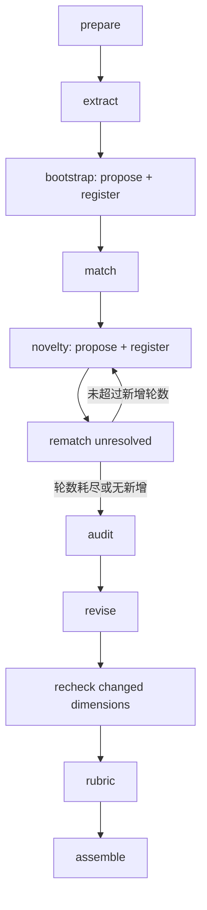

# S2 流程与执行架构

日期：2026-11-12。字段定义见 [阶段协议](03-数据契约与阶段协议.md)，代码落点见 [实现要求](04-实现要求与默认Skill替换.md)。本页参数均为首版待实现初始值，不是 Seed 的已验证容量上限。

## 1. 责任边界

- API：认证、输入校验、短事务受理，创建一个 job 和 `worker_tasks`，返回 202。
- Worker Handler：执行状态机、规划任务包、调用 OV、登记版本与汇总，不新增独立 Service 层。
- PostgreSQL：任务、冻结配置、单元状态、回执索引、维度版本、Evidence 关联与审计的唯一可变权威源。
- OV：冻结输入制品、Compile Task、Embedding 与最终知识制品；不是通过不断追加全文来承担业务状态机。
- Seed：完成宿主明确分配的一个阶段语义任务，不自行遍历全库或规划业务迭代。

同一个业务 job 对应多个内部执行单元，多个兼容的小单元可封装为一个 Compile。用户不创建第二个任务来接力。

## 2. 状态机

宿主阶段与模型 stage 分开：模型 stage 只有 `extract / propose / match / register / audit / revise / rubric`。bootstrap、novelty 复用 propose/register；recheck 复用 audit，gap_review/gap_review_final 复用 register 做全目录遗漏核对。没有 `merge` 阶段，也不执行 S0 的窗口归并。

空阶段有明确完成回执：没有发现时可交付零维度，说明原因，不能伪造发现。依赖缺失单元时可形成 partial 交付，但不能把未处理案例计为已分析。

## 3. Prepare 与 Extract

受理冻结数据清单摘要、原文版本、模型输入渲染版本、完整 Skill 正文及摘要、配置 revision、预算和模型/Embedding 可取得的身份信息。

已有 S0 准备目录可读白名单原始案例，经 v1 解析器验证后渲染为 S2 模型输入；旧 findings、dimensions、评分 notes 不导入。直接原始上传的数据准备作为同 job 的 prepare 子阶段完成。

每个 extract 单元包含一条完整案例，输出具体行为 Evidence、候选评价问题和限制。宿主生成正式 evidence_id、恢复坐标。成功接受的案例通过唯一键避免重复消费；失败只重试该案例。超大完整案例不能静默截断，进入 capacity_pending。

## 4. Bootstrap：从多样材料起步

宿主为全部可消费 Evidence 建立紧凑向量描述：具体行为、候选评价问题、关键条件。保留原始正文，向量描述不替代原文。

初始案例选择：每个知识点最多选择 2 条包含可用 Evidence 的案例，优先不同场景和不同表达模板，总计最多 54 条；同等条件用稳定摘要排序。它是建库材料选择上限，不是一次调用的大小，也不按最短对话抽样。

对选择的 Evidence 做跨知识点近邻组织，每个 propose 包最多 8 条、受字符预算限制。分组只负责安排比较，不等于正式维度。propose 可以提出至多 3 张紧凑定义卡及明确成员去向，不生成评分口径。

全部 proposal 进入 job 内唯一登记队列，按稳定顺序执行 register。每个 proposal 都基于登记时最新的注册表比较，登记成功后下一个 proposal 才提交。跨组同义 proposal 因而有机会关联已经登记的维度，而不是各自生成正式 ID。

## 5. Match：并行判断、集中更新

冻结当前 `registry_revision`，对全部尚无明确去向的 Evidence 规划 match 包；bootstrap 已关联的成员不重复生成定义。

每条 Evidence 初次召回最多 5 个维度，使用向量近邻加评价目标词面匹配；不以章节做硬过滤。一个包最多 8 条 Evidence，包含去重后的候选定义卡，并提供每条 Evidence 的允许候选 ID。

Seed 返回 attach、method_variant、unmatched、routine、uncertain。attach/method_variant 仅追加关联或方法，不改变维度评价目标，不创建维度。价值为 mixed 的 Evidence 允许关联但不能伪装为纯正向支持。

同一 wave 的任务只读同一版本，所有关联提交时检查版本与 ID。方法分支先保存提议，集中去重追加；各模型任务不得直接修改共享定义。

unmatched 不立即等于新能力。先扩展召回到最多 12 个候选，分成有界包补查；仍无法归属且确有可评价价值的材料才进入 novelty。召回不足、模型不确定、普通动作分别记录，不混入新维度数量。

## 6. Novelty 与 Register：避免重复登记

novelty 池合并本轮所有 match 包的未归属材料，跨来源近邻组织后调用 propose。单例允许保留，不能为支持数凑组。

register 对一个 proposal 进行逐页比较：每页最多 6 张维度卡，优先检索相关卡；若准备创建新维度，则须补齐对当前注册表全部紧凑卡的比较。已有明确 same_dimension/method_of 关系后可停止剩余页；出现多个不兼容目标或 uncertain 时先保留待核实，不自动创建新维度。

所有页固定同一 registry_revision。宿主汇总关系：

- 唯一已确认目标：关联已有维度，保存原 proposal 与来源。
- 所有已登记维度均完成比较且均 different：创建一个新维度，宿主分配 ID。
- 有歧义或比较页不完整：deferred，不以超时或缺结果代替“无同义维度”。

语义判断仍可能出错；该机制保证登记流程集中与身份唯一，不宣称自然语言概念绝对无重复。近邻边界检查和原文 audit 继续保留。

登记提交使用 PG 行锁或 revision CAS，附注册决定的期望 revision。失配时重读并重做受影响比较，不覆盖新版本。首版同 job 只允许一个登记提交者，跨 job 独立。

每轮新增后只重匹配 unresolved 成员，不重跑已成功 extract。`novelty_rounds=2` 表示初次全量 match 后最多两轮集中新增；轮数耗尽或本轮无新增即进入 audit。未解决成员保留明确状态与原因。

## 7. Audit：检查原文，不重新开放提取

冻结候选目录。对每条案例与每个拟进入评分的候选维度完成一条审计记录；目录分成每包最多 4 个维度，输入仍是一条完整原始案例。

不依赖检索命中决定哪些维度被检查。分母由明确的适用性与证据充分性判断产生，不能用“没有抽到 Evidence”推出“不适用”或“未体现”。

输出 applicable/sufficient、support/mixed/counter/not_demonstrated，以及原文句子定位。不适用和证据不足分别记录为 N/A、NE，不是零分。客户模拟器异常和角色无法确认的范围不能当作真实反馈依据。

audit 可以记录局部 `uncovered` 和句子引用，不能输出第二套 observations。宿主按案例、引用与评价问题去重，使用 register 对全目录分页核对；已有维度覆盖的遗漏不进入新增修订，不确定或缺页明确待复核。每个确认的全局遗漏单独进入 revise 包，不使用全局前六条。程序汇总 case × dimension 覆盖矩阵、去重支持案例、场景分布、方法多样性和冲突；不由模型计算全库数量。

## 8. Revise、Recheck 与 Rubric

修订最多一轮。维度按语义邻近分为最多 3 个一组；代表材料按完整 Evidence 与完整轮次审计上下文选择，支持、反证与混合表现交错尝试，并遵守实际字符/字节预算。每个维度至少保留一条已有成员 Evidence；组无法容纳时拆成更小的维度组。省略的代表材料及选择统计持久化并交付，不按句子数量截断原文。

允许 keep、改定义、归并、拆分、新增、改为方法库或待核实项。新增/拆分仍必须经过 register；不能绕过集中登记。模型只提交 patch，宿主应用并记录版本。

改名/别名等不改变含义的操作可重映射。定义、适用条件、拆分、归并或新增属于语义变化，旧 audit 失效；对变更后的维度重新检查全部案例，不能仅检查旧命中案例。有语义变更时对全部非 routine Evidence 重新匹配，旧关系保留为非活动历史，关系保留版本。

recheck 不再启动下一轮 discovery/revise。仍存在冲突的维度进入 needs_review 或 evidence_only，其他维度继续。修订或复核因任务数预算未完成时保留 partial，不能假称语义完成。

最终冻结目录。每个进入评分输出的维度创建一个 rubric 单元，带完整定义、适用条件、有限支持/反证与方法。成功回执只消费一次；只重试失败单元。不因成员增多再次生成相同评分口径。

## 9. 初始任务包预算

| 参数 | 首版初始值 | 语义 |
| --- | ---: | --- |
| seed_cases_per_point / seed_case_limit | 2 / 54 | 建库材料选择上限 |
| propose_items / proposals_per_packet | 8 / 3 | 紧凑行为数与新定义提议数 |
| match_items / candidate_top_k | 8 / 5 | 一个匹配包的上限 |
| expanded_candidate_limit | 12 | 首次未匹配后的有界补查上限 |
| register_page_dimensions | 6 | 新候选逐页比较的卡片数 |
| audit_dimensions | 4 | 每案例每包审计维度数 |
| packet_input_chars / packet_input_bytes | 12000 / 48000 | 序列化业务包上限，包含定义卡和原文 |
| packets_per_compile / compile_input_chars | 4 / 32000 | 同阶段独立包合并提交的上限 |
| max_inflight_compiles | 1 | 首版保守值，不代表 OV 内部 child 并发为 1 |
| novelty_rounds / revision_rounds | 2 / 1 | 固定停止条件 |
| repair_attempts_per_unit | 2 | 首次尝试外的补偿次数 |
| max_model_units | 1500 | 单 job 总计划模型单元上限，防止失控；不是期望调用量 |

这些限制取交集，不能只检查条数。更长案例单独规划，超限登记 pending；不默默切掉最后一轮客户回应。正式运行前用真实 Seed 请求测得的容量调整默认值，受理后不可原地修改。

完整模型请求还必须满足：system + 当前阶段 Skill + tool schema + assignment + tool history + output reserve + margin 不超过实际模型上下文限制。字符预算不能换算成未经验证的固定 Token 比例。宿主记录业务包大小，OV 实际请求需要观测 Token 与工具回读增量。

## 10. OV 执行与吞吐

每个任务包是独立 Markdown 文件，一次 Compile 只包含同 stage、同注册表快照且总量合规的文件。Map 使用 execution=agent、input_unit=file、output=files，随后 Finalize。禁止重复 Map/Shuffle/Reduce 和一个 Reduce 承担全流程。

共享定义登记具有先后依赖，不将多个尚未登记的 proposal 当作互不相关的并行创建。match、audit、rubric 可以批量 Map；register 同一候选的多个只读比较页可以按总预算批量。

Entry 尽早交回流水线；宿主按阶段裁剪 Skill，避免每个 child 加载全部阶段。既限制单文件，也限制 Compile 总输入、预期输出与 Review 范围。不能仅把限制写进模型规则。

宿主不能绕过 OV 的正式完成状态，把 scratch 文件当作完成交付。现有 deferred batch-write 用于宿主写入，不等于 Compile Finalize 可以跳过 Semantic/Embedding。

## 11. TPM 与失败分类

并发槽与每分钟 Token 预算分别控制。严格 TPM 限制需要在实际模型入口统一管理，包含 Entry、Planner、Map、Review、压缩及重试；仅限 Compile 数量只能减少压力，无法作硬保证。

首版不要求修改 OV 源码。部署前核对已有 Provider/网关限流能力；缺乏统一入口时采用保守提交与可观测退避，并明确该限制。429 按服务端提示/指数退避，不立即重复大请求；等待不消耗语义修复次数。

容量错误应缩小未来任务包或登记 capacity_pending，不能对同一超大请求反复重试。已冻结单元若要拆分，创建有父单元引用的新子单元并保留覆盖，不改原快照；完整单案例仍超限则待处理。

语义不确定允许 deferred；越界来源、错误版本、外来 ID、无法解析回执阻断当前单元。局部失败不删除其他有效回执。

## 12. 持久化、幂等与取消

单元状态：planned → submitting → running → accepted，失败进入 retry_wait、deferred 或 failed。未知提交进入 reconciling。job 状态复用平台现有状态，业务进度放独立 stage 字段。

幂等键包含 tenant/job/stage/unit、输入摘要、Skill 摘要、registry revision 和 attempt；网络重发使用同一键，不能变 attempt。只有确认失败的补偿才增加 attempt。任务取消后停止新提交，对在途 Compile 取消并对账，不提前释放未知远端占用。

回执落库、关联更新、版本 CAS 与消费标记在可恢复的短事务中完成。Worker fence 检查阻止过期执行者写回，跨副本锁使用 PG；不使用本机目录或进程锁作为恢复依据。

## 13. 交付状态

执行完整与评分可用分开：所有案例/单元有终态可为 complete；有容量或执行缺口则 partial。完整任务可以含 needs_review、rubric_pending 或零维度，不能将其描述为已完成评分校准。

最终报告包含提取覆盖、每轮未匹配量、登记复用/新增数、audit 完整度、最终评分维度与 evidence_only 数、原文引用、性能和问题清单。

uncertain Evidence 参与后续有界扩大匹配和补充发现；最终未解决的 Evidence、gap 或 pending rubric 使交付为 partial。复核后再次核对遗漏是否已被最终目录覆盖，不启动第二轮修订。
